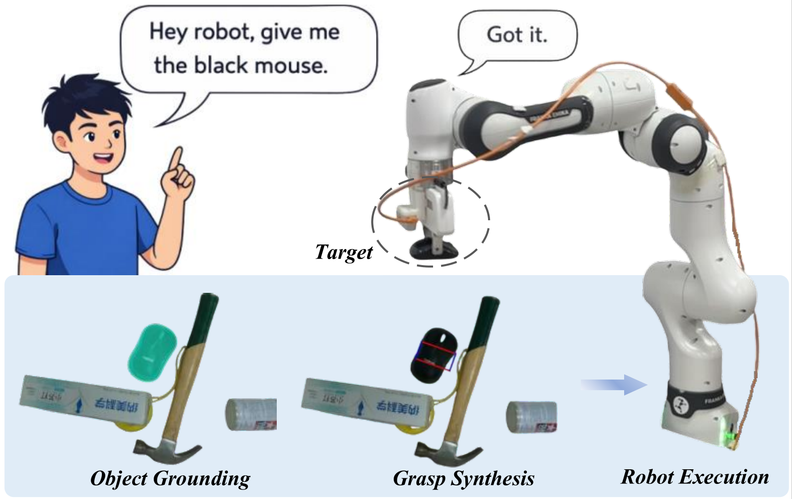

# MambaRGS

This repository hosts project resources for our IEEE Robotics and Automation Letters (RA-L) paper:

**MambaRGS: Referring Grasp Synthesis via Text-Image Cross-State Modulation and Rotation-Adaptive Decoding**

MambaRGS is a Mamba-based framework for **referring grasp synthesis (RGS)** that jointly predicts the referred object's pixel-wise mask and a planar grasp from an RGB image and a natural language expression in cluttered robotic scenes.

The framework incorporates:

- **Text-Image Cross-State Modulation (TICM):** a task-oriented module that couples visual context, global linguistic semantics, and local text-image correlations through three state-space branches and cross-state modulation.
- **Rotation-Adaptive Decoder (RAD):** a decoder that adapts **Adaptive Rotated Convolution (ARC)** to language-conditioned multi-scale decoding, adjusting convolutional receptive patterns to local feature orientations for orientation-sensitive grasp prediction. ARC is an existing operator adopted in this framework.

## Supplementary Materials

Due to the strict 8-page limit of IEEE RA-L, additional details that could not be included in the revised manuscript are provided in the supplementary appendix.

* [Supplementary Appendix](./Appendix.pdf)

## GraspNet-VLG

We construct **GraspNet-VLG**, a real-world referring grasp synthesis benchmark built upon GraspNet-1Billion. It associates cluttered RGB-D scenes with:

* natural language referring expressions;
* pixel-wise target object masks;
* planar grasp annotations for referred objects.

The corrected GraspNet-VLG benchmark contains:

* 2,500 RGB-D images;
* 17,813 image-target-mask samples;
* 106K referring expressions;
* 87 valid object categories;
* 163,466 valid grasp rectangles.

The dataset split follows an image-disjoint 70/10/20 train/validation/test protocol to avoid image-level leakage.

Dataset release information will be updated in this repository.

## License

This repository is released under the Apache-2.0 License.
